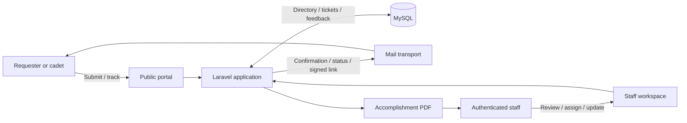
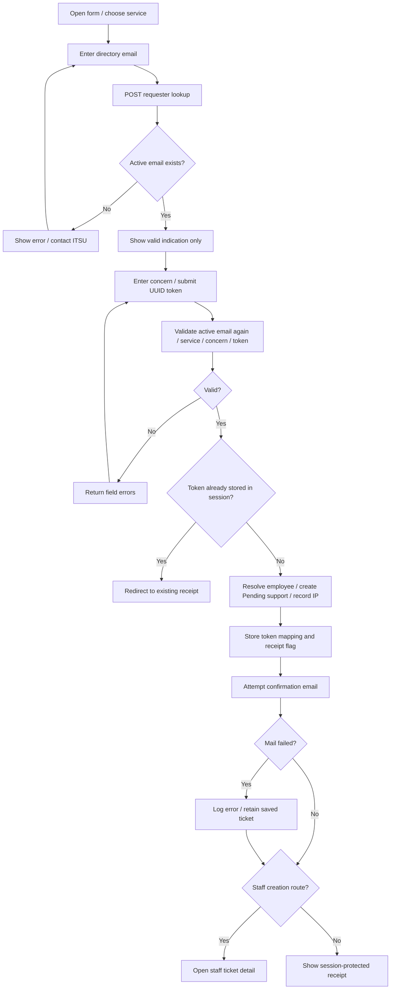
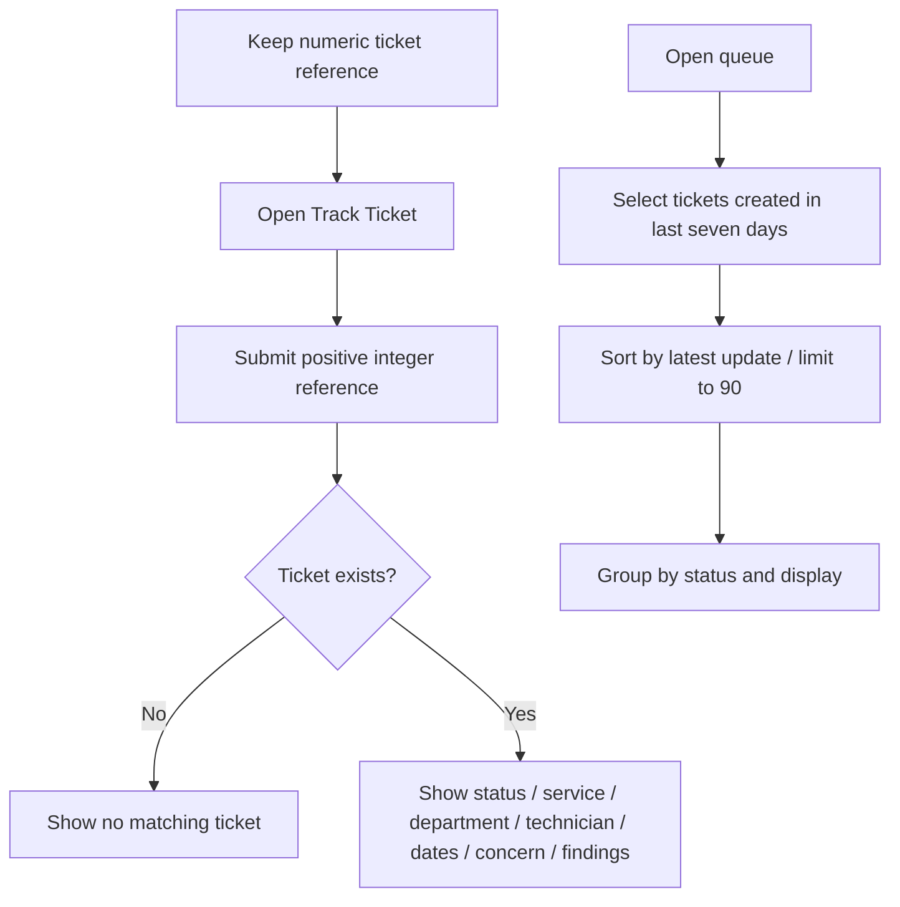
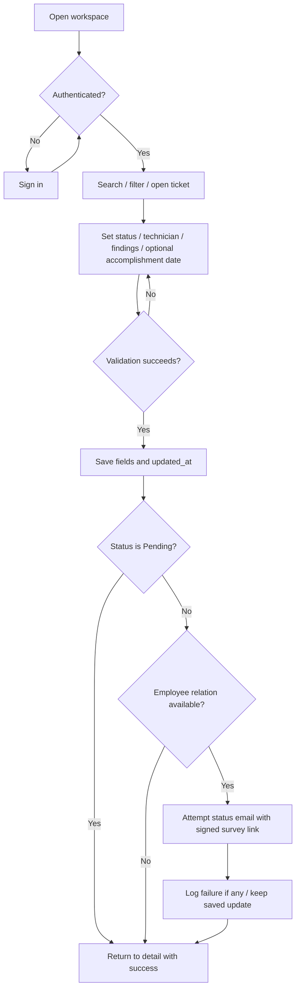
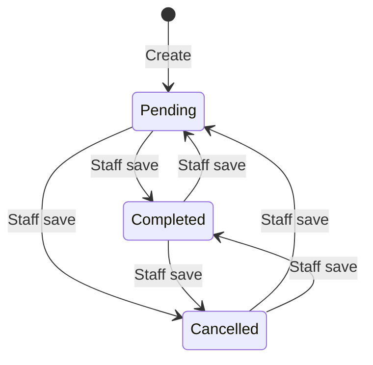
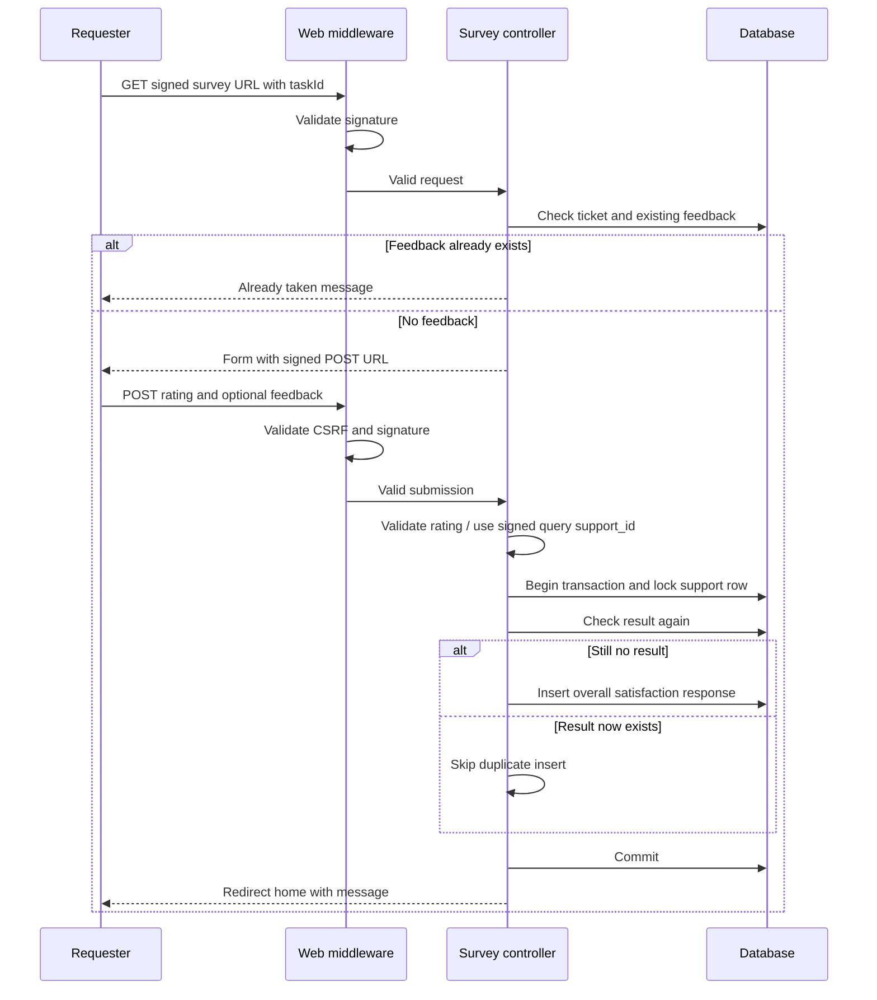
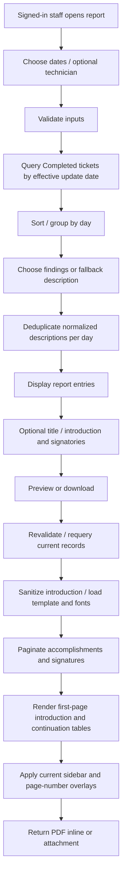
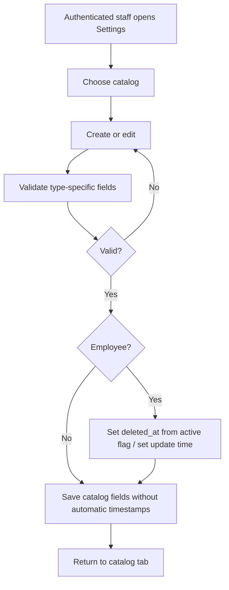
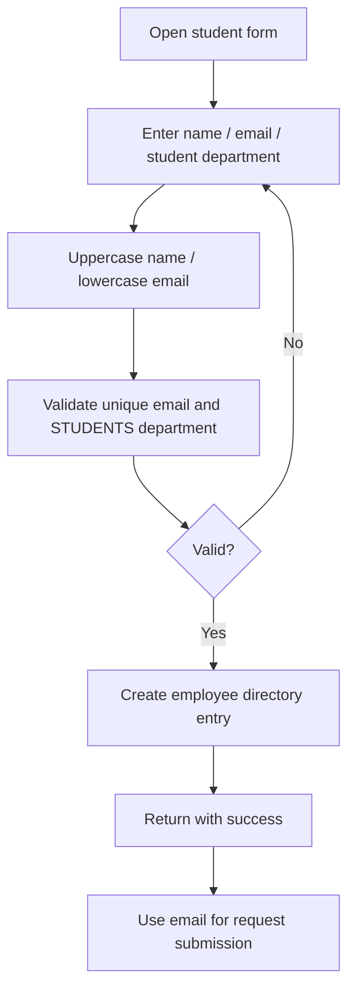

# PMMA Helpdesk — Process Flows

Reviewed: **7 November 2026**. Diagrams describe active helpdesk behavior. Legacy handlers can follow different rules; see [technical limitations](TECHNICAL_SPECIFICATIONS.md#access-controls-and-limitations).

[README](../README.md) · [System documentation](SYSTEM_DOCUMENTATION.md) · [Technical specifications](TECHNICAL_SPECIFICATIONS.md)

Diagrams use Mermaid. View in a Markdown viewer with Mermaid support; accompanying prose/tables provide text explanations.

## 1. System context

Requesters, technician records, and staff credentials are separate. Assignment does not grant login access or limit ticket editing to that technician.

## 2. Request submission

| Stage | Result |
| --- | --- |
| Lookup | Confirms active email without returning directory profile fields |
| Validation | Rejects invalid input; public assignment of a technician is prohibited |
| Duplicate check | Successful token already in this session redirects instead of inserting |
| Save | Creates `Pending` with employee/service references and IP; staff may assign technician |
| Notification | Synchronous mail attempted after saving; delivery failure does not undo ticket |

The token check is session-scoped, not a database uniqueness guarantee. Repeated tokens follow the receipt path even if originally submitted through the staff route.

## 3. Tracking and queue

Receipt access requires the originating session; public tracking does not verify ownership. The home page separately loads the latest ten tickets without the queue's seven-day creation filter.

## 4. Staff ticket handling

The optional accomplishment date is written to `updated_at`; otherwise current time is used. A non-pending save attempts email even without a status change.

### Status transitions

Saving the same status is also allowed. Completed/cancelled are not enforced terminal states. Findings and technician are optional even at completion.

## 5. Signed feedback

Invalid signatures stop before controller execution. A posted ticket ID cannot replace the signed query. The transaction/parent lock guards the active path against repeat responses; the legacy schema has no unique ticket-response constraint. Save does not require a completed ticket. Links do not expire by default or prove individual recipient identity.

## 6. Accomplishment report

| Stage | Rule |
| --- | --- |
| Eligibility | `Completed` within inclusive `COALESCE(updated_at, created_at)` dates; optional technician match |
| Description | Findings → concern → service name → generic completion text |
| Grouping | Effective update day; equivalent text once per day |
| Editable text | Request-scoped, sanitized; fixed renderer fonts |
| Output | Original page size, current overlays, no persistent report archive |

Browser table search/sort does not alter PDF filters. Export queries current records again, so changes after viewing may affect output. Signatory fields label the document; they do not record an approval transaction.

## 7. Catalog maintenance

Deactivation prevents new active-directory submissions while preserving historical ticket associations. Related catalog labels are resolved from current records, not snapshotted per ticket.

## 8. Cadet directory registration

The `STUDENTS` department must exist. This registration does not create a staff user or password.
