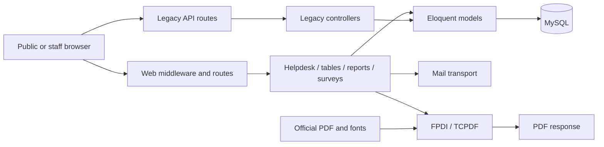
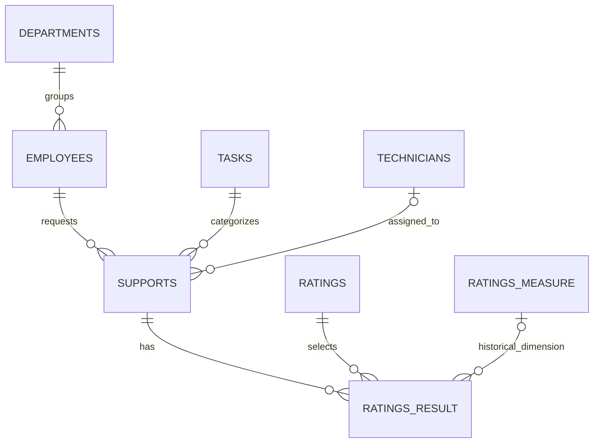

# PMMA Helpdesk — Technical Specifications

Reviewed: **7 November 2026**. Source: repository implementation and bundled SQL table definitions, not a live production inspection.

[README](../README.md) · [System documentation](SYSTEM_DOCUMENTATION.md) · [Process flows](PROCESS_FLOW.md)

## Architecture

A Laravel monolith renders Blade pages, persists through Eloquent, and uses session authentication. JavaScript enhances the interface. The active helpdesk presentation adapts the existing schema without installing the reference ZIP's backend/database.



| Component | Source |
| --- | --- |
| Bootstrap | `public/index.php` delegates to root `index.php` |
| Route mounting | `app/Providers/RouteServiceProvider.php`; web group and `/api` group |
| Active portal/staff logic | `app/Http/Controllers/HelpdeskController.php` |
| Table queries | `app/Http/Controllers/DashboardTableController.php` |
| Report selection | `app/Http/Controllers/ReportController.php` |
| PDF and HTML cleanup | `app/Services/Reports/AccomplishmentPdf.php`, `ReportContent.php` |
| Feedback/cadet logic | `SurveyController.php`, `LoginController.php` |
| Authentication | Auth controllers and `app/Http/Requests/Auth/LoginRequest.php` |
| Branding | `config/helpdesk.php`, injected through `AppServiceProvider` |
| Presentation | `resources/views/helpdesk`, `public/helpdesk` |

## Dependencies and configuration

| Layer | Repository declaration or implementation |
| --- | --- |
| PHP | Composer `^8.0.2`; Windows launcher explicitly selects PHP 8.2 |
| Framework | Laravel `^9.19` |
| Database | MySQL-compatible legacy schema; local launcher references MySQL Community 8.4 |
| Libraries | Guzzle `^7.2`, Sanctum `^3.0`, Tinker `^2.7` |
| PDF | FPDI `^2.6`, TCPDF `^6.10`, bundled generated Cambria/Arial fonts |
| PHP tests | PHPUnit `^9.5.10`, SQLite memory by default |
| Asset build | Vite `^4.0.0`, Laravel Vite plugin `^0.7.2`, Tailwind `^3.1.0`, Alpine `^3.4.2` |
| Active vendor assets | Bundled DataTables 2.3.4, jQuery, Chart.js, Bootstrap Icons |
| Time/locale | `config/app.php`: `Asia/Singapore` (UTC+08:00), English |

Versions above are repository ranges, not claims about the newest releases. Lockfiles determine resolved versions. Check installed requirements with `composer check-platform-reqs`. MySQL needs PDO MySQL; isolated tests need PDO SQLite; report HTML cleanup uses DOM/libxml. Python is needed only for optional PDF QA.

| Environment settings | Purpose |
| --- | --- |
| `APP_ENV`, `APP_DEBUG`, `APP_URL` | Environment, debug exposure, generated URLs/signatures |
| `APP_KEY` | Encryption and signed links; preserve in existing deployments |
| `DB_CONNECTION`, `DB_HOST`, `DB_PORT`, `DB_DATABASE`, `DB_USERNAME`, `DB_PASSWORD` | Database access |
| `MAIL_MAILER`, other `MAIL_*` | Transport/from settings; local `array` suppresses delivery |
| `SESSION_DRIVER`, `SESSION_LIFETIME` | Login, receipt flags, submission tokens |
| `CACHE_DRIVER`, `LOG_CHANNEL`, `LOG_LEVEL` | Cache/rate limiting and diagnostics |
| `QUEUE_CONNECTION` | Framework setting; active ticket code still uses synchronous `send()` |

Serve `public/`, never the repository root. Keep environment files, database exports, credentials, and ZIP sources outside web exposure. Setup and test commands are in the [README](../README.md).

## Database

The dictionary reflects **CREATE TABLE definitions** from the bundled SQL export, without copying record contents. Principal tables have auto-increment unsigned bigint `id` primary keys. Reference columns are mostly signed bigint without declared foreign keys in that export. Relationships below are logical, not SQL-enforced guarantees.

| Table | Main fields/types | Purpose |
| --- | --- | --- |
| `departments` | `name varchar(255)` | Department catalog |
| `employees` | `name`, `email`: varchar(255); `department_id bigint`; nullable `deleted_at`, `updated_at` timestamps | Requester directory; no `created_at` |
| `technicians` | `name varchar(255)`, unique `email varchar(255)` | Assignable personnel; no timestamps |
| `tasks` | `name`, `content`, `icon`: varchar(255) | Services; no timestamps |
| `supports` | `employee_id`, `task_id`: bigint; nullable `technician_id bigint`; `status varchar(255)`; nullable `support_specifics longtext`, `findings varchar(1023)`; `ip varchar(255)`; nullable timestamps | Tickets |
| `ratings` | `name varchar(255)` | Rating choices |
| `ratings_measure` | `name`, `description`: varchar(255) | Historical survey dimensions |
| `ratings_result` | `support_id`, `rating_id`, `rating_measure_id`: bigint; nullable `feedback varchar(255)` and timestamps | Responses |
| `users` | `name`, unique `email`, `password`: varchar(255); nullable verification timestamp, remember token, timestamps | Login accounts |
| `employee_department` | `employee_id`, `department_id`: int | Legacy pivot; active flow uses `employees.department_id` |

Framework tables include `password_resets`, `personal_access_tokens`, `failed_jobs`, and `migrations`.



Important implementation details:

- Historical migrations differ from the supplied schema, including the current findings column. Do not assume `migrate:fresh` reconstructs it.
- `employees.email` has no unique database index in the inspected export. Active forms validate uniqueness but that is not a database guarantee.
- `ratings_result` has no unique ticket constraint. Active survey save locks the parent ticket within a transaction before checking/inserting.
- Overall feedback uses `rating_measure_id=0`, which may have no corresponding measure row; views use an overall satisfaction fallback.
- `updated_at` serves as both last update and report/completion date; no independent `completed_at` exists.
- Catalog saves disable automatic timestamps. Employee saves explicitly set `updated_at`.
- Some legacy inverse model methods declare `hasOne` despite multiple possible ticket references. The ER diagram expresses logical relationships. Active ticket pages resolve department through employee rather than `Support::department()`.

## Routes and interfaces

Web mutations use CSRF middleware. `auth` denotes the shared login session, not a staff role or per-ticket ownership check.

| Method | Path | Access/purpose |
| --- | --- | --- |
| GET | `/`, `/services`, `/services/{slug}` | Public portal/catalog; numeric service slug; search `q` |
| GET | `/tickets/create` | Public form; optional category/email prefill |
| POST | `/tickets/requester` | Public lookup; 20/min |
| POST | `/tickets` | Public create; 10/min |
| GET | `/tickets/receipt?ticket=…` | Origin-session receipt flag required |
| GET, POST | `/track` | Public positive integer `reference`; 30/min |
| GET | `/queue`, `/faq`, `/contact`, `/privacy`, `/phone` | Public queue/information |
| GET | `/time` | Epoch milliseconds, `synced=false`, no-store |
| GET / POST | `/student` / `/student/store` | Cadet form / directory registration |
| GET | `/dashboard` | auth; ticket filters/charts |
| GET / POST | `/dashboard/tickets/create` / `/dashboard/tickets` | auth; staff form / create |
| GET, POST | `/dashboard/tickets/{ticket}` | auth; read/update |
| GET | `/dashboard/settings` | auth; catalog tab list |
| GET | `/dashboard/settings/{type}/create`, `/dashboard/settings/{type}/{id}` | auth; create/edit form |
| POST | `/dashboard/settings/{type}/{id?}` | auth; catalog save |
| GET | `/dashboard/queue`, `/dashboard/surveys` | auth; queue/results |
| GET | `/dashboard/tables/tickets`, `/dashboard/tables/catalog/{type}`, `/dashboard/tables/surveys` | auth; read-only table JSON |
| GET, POST | `/report`, `/report/pdf` | auth; report/PDF |
| GET | `/take-survey?taskId=…&signature=…` | Signed survey form |
| POST | `/survey?support_id=…&signature=…` | Signed + CSRF response submission |
| GET, POST | `/login`, `/register` | Guest sign-in/self-registration |
| POST | `/logout` | auth; end session |
| GET, PATCH, DELETE | `/profile` | auth; own profile view/update/delete |

`routes/auth.php` also defines password recovery, confirmation/update, and verification. Staff routes generally do not require `verified`. `/feedback` redirects to Microsoft Forms.

Compatibility routes include `/index`, `/info`, `/notify`, `/ticket`, `/support`, `/edit`, `/save`, `/support-admin`, `/add`, `/tech`, and `/admin*`. `/admin`, `/admin.php`, `/admin/index.php`, and `/admin/index` lead to the authenticated workspace; `/admin/login` redirects to `/login`. Legacy writes can use different rules from the active helpdesk handlers.

### Validation contracts

| Operation | Fields/rules |
| --- | --- |
| Email lookup | Required valid `email`, max 255; success `{"valid":true}`; unregistered/inactive 422 with `valid:false` and message; private/no-store |
| Create ticket | Active `email`; existing integer `task_id`; required `support_specifics` max 10,000; UUID `submission_token`; nullable existing technician only on staff route, prohibited publicly |
| Update | Required status in `Pending`, `Completed`, `Cancelled`; optional existing `technician_id`; nullable `findings` max 1,023; nullable date `accomplished_at` |
| Catalog | Name max 255; employee/technician email uniqueness validation; employee existing department and boolean active; service content/icon required max 255 |
| Survey | Existing integer `satisfactionRating`; nullable feedback max 255; ticket comes from signed query |
| Report | ISO dates `from`/`to` ordered; optional existing technician; signatory fields max 100 each; `content_html` max 12,000; boolean `download`, `content_default` |

HTML form validation normally redirects; JSON requests receive validation responses. Missing records return 404, invalid signatures 403, throttles 429. These routes are not a versioned external integration API.

### Dashboard table protocol

Input accepts `draw`, `start`, `length`, `search[value]`, and one `order[0][column|dir]`. Search is limited to 200 characters; rows to 100 (`length=-1` maps to 100). Sort columns come from server allowlists. Tickets also accept status/service/department/technician filters.

Responses contain `draw`, `recordsTotal`, `recordsFiltered`, and **`rows` containing rendered HTML**, not a standard DataTables `data` array. Local scripts adapt it. Ticket totals are measured after explicit filters and before table search. Responses use private/no-store. Blade tables/pagination remain the JavaScript-free fallback.

## PDF report contract

Query `Completed` tickets by inclusive `COALESCE(updated_at, created_at)` dates and optional technician, ordered by effective date and ID. Group by date and deduplicate normalized descriptions within each day. Description order: findings → concern → service name → generic completion text. Grouped PDF output does not add separate ticket-ID or department columns.

| Property | Implementation |
| --- | --- |
| Source | `resources/reports/ar_blank.pdf`, native-size import |
| SHA-256 | `f48a60f70b022f43a2b720a3864e4ae5dbaf18e882ebf3026733f4cc106e4eb6` |
| Paper | Portrait, 595.44 × 841.68 PDF points |
| Body | Left 108.02, right 561.96, divider 256.85 pt |
| Table start | First page default 192.62; continuation 108.5 pt; custom introduction can shift first table |
| Table bottom | Page height minus 33.48 pt |
| Fonts | Cambria 12 pt narrative/headings/signatures; Arial 11.04 pt accomplishments |
| Template overlays | Red sidebar label masked at `(29, pageHeight−147.5, 50, 17)`; multipage numbering |
| Introduction | First page only; excessive height rejected |
| Storage | Signatories/introduction request-scoped; no report archive |
| Response | PDF inline by default, attachment with `download=1`; private/no-store and nosniff |

`ReportContent::clean()` retains basic emphasis, paragraph/block text, line breaks, and supported alignment. It removes executable/resource tags, arbitrary attributes, and font overrides; the renderer sanitizes again. Report fonts/template are bundled; no Python or browser print engine is required for export.

## Access controls and limitations

Implemented controls include active staff session authentication, web CSRF, signed feedback URLs, active-email checks, origin-session receipts, bounded table inputs, server-owned sort allowlists, and escaped Blade values. Login throttling uses email/IP with a threshold of five failed attempts. The API group limits traffic to 60 requests/minute per user or IP.

| Area | Observed boundary |
| --- | --- |
| Registration | Guest `/register` creates and signs in a user; no approval or staff-role gate |
| Authorization | Staff routes use `auth`; no technician-specific record isolation or role hierarchy |
| Tracking | Public numeric reference reveals concern/findings and department/technician/dates without ownership verification |
| Email check | Confirms active directory membership, not mailbox ownership |
| Legacy API reads | Search/directory/support/survey endpoints lack explicit route authentication |
| Legacy API writes | GET `/api/update`, `/api/add`, `/api/remove`, `/api/create-ticket`, `/api/supportUpdate` mutate records without explicit auth or web CSRF |
| Sanctum | `/api/user` explicitly uses `auth:sanctum`; package presence does not protect other routes |
| Signed feedback | Links have no expiry and can be forwarded; they do not establish recipient identity |
| Mail | Synchronous active sends log failures after saves; no automatic retry record |
| History | No immutable completion timestamp, audit log, or stored report snapshot |
| Database | Legacy export lacks many reference/uniqueness constraints |

For restricted deployment, self-registration, legacy route access, public data exposure, and schema constraints require implementation decisions. Documentation changes do not fix these behaviors.

## Verification and maintenance

Commands are in the [README](../README.md#verification). Existing helpdesk feature tests cover active-email validation, ticket mapping/duplicate tokens, login/logout, catalogs, signed feedback, report selection/PDF dimensions, table bounds, and HTML cleanup. Authentication tests separately cover the account scaffold.

SQLite tests construct an isolated schema; MySQL integration uses actual local table definitions in a disposable database. DOM checks exercise bundled scripts without establishing visual layout or mail delivery.

For an exported PDF, the existing optional utility is:

```powershell
python scripts/verify-report-pdf.py path/to/export.pdf
```

It requires `pdfplumber`, `pypdfium2`, and Pillow. Its pixel/sidebar and bottom-margin assertions reflect an earlier layout contract and may fail against the current sidebar mask/table bottom. Reconcile these assertions with the approved layout before using it as an acceptance gate; do not modify the original template to satisfy stale assertions.

The repository does not establish production capacity, uptime, recovery-time objectives, data retention, or a tested browser matrix. Define and verify those operational requirements separately.
